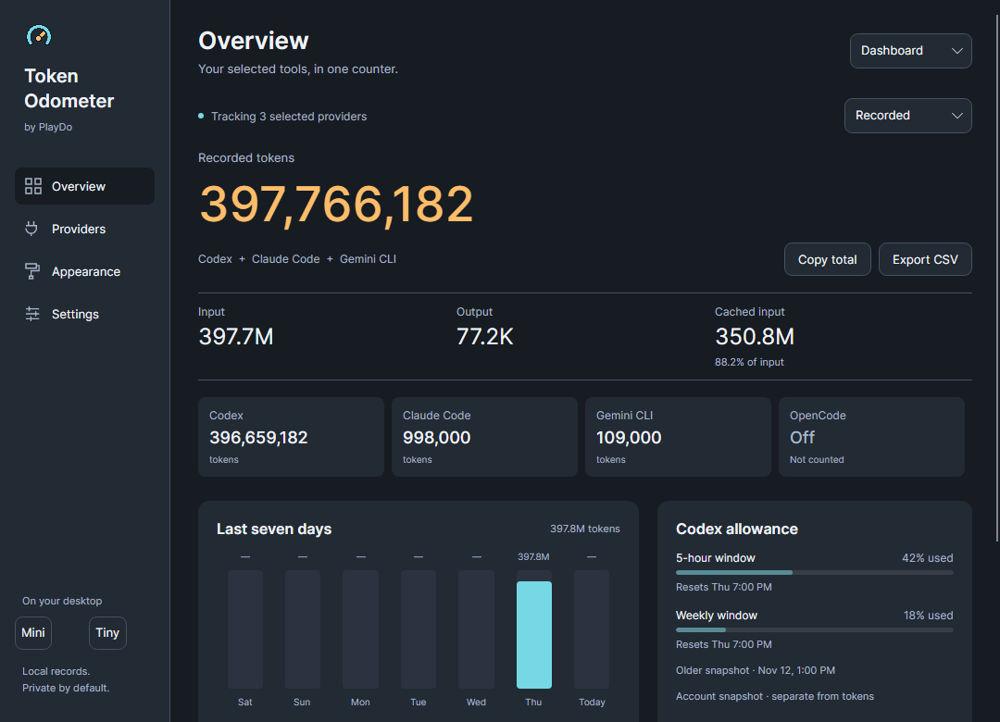
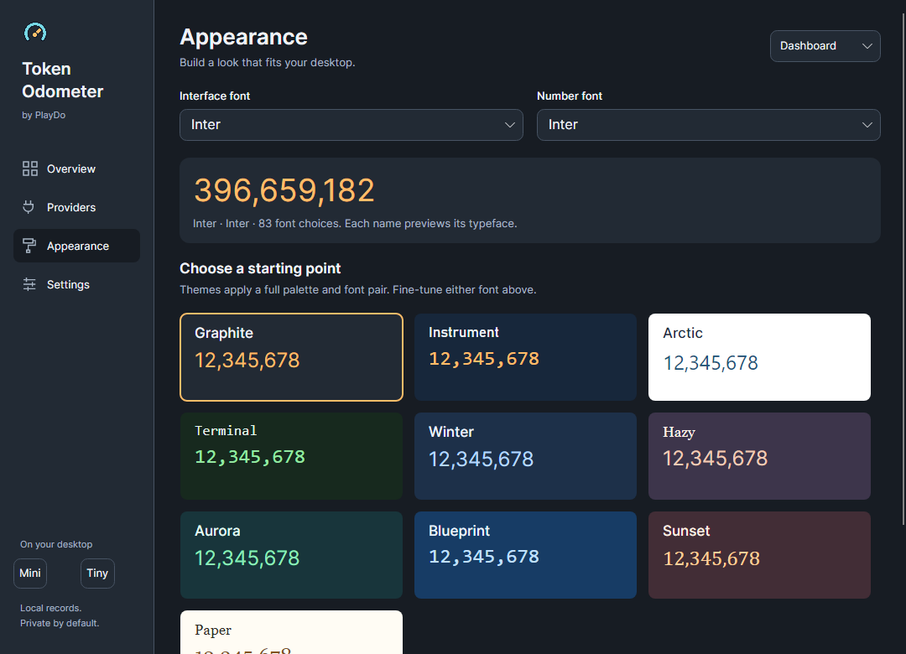

# PlayDo’s Token Odometer

### An extremely customizable AI token odometer for Windows and macOS

Track the tools you use. Choose a look that fits your desktop. Keep the full dashboard open or tuck a number-only Tiny widget into a corner.

**Free and open source. Local records. No account keys or background AI calls.**

| Download v0.6.1 | Package |
| --- | --- |
| [Windows x64](https://github.com/p7kbk748qb-debug/playdo-token-odometer/releases/latest/download/PlayDo-Token-Odometer-0.6.1-win-x64.zip) | Self-contained ZIP |
| [Mac — Apple Silicon](https://github.com/p7kbk748qb-debug/playdo-token-odometer/releases/latest/download/PlayDo-Token-Odometer-0.6.1-osx-arm64.dmg) | Drag-to-Applications DMG |
| [Mac — Intel](https://github.com/p7kbk748qb-debug/playdo-token-odometer/releases/latest/download/PlayDo-Token-Odometer-0.6.1-osx-x64.dmg) | Drag-to-Applications DMG |

[Release notes and SHA256 checksums](https://github.com/p7kbk748qb-debug/playdo-token-odometer/releases/latest) · [Project website](https://p7kbk748qb-debug.github.io/playdo-token-odometer/) · [MIT license](LICENSE)



Screenshots use synthetic reports. They do not contain the owner’s usage history.

## Make it yours

- **Ten coordinated presets:** Graphite, Instrument, Arctic, Terminal, Winter, Hazy, Aurora, Blueprint, Sunset and Paper.
- **Font variety:** choose installed serif, sans, monospace and display families. Every name previews its own typeface, including the selected font. Interface and number fonts are independent.
- **Four layouts:** Dashboard, Compact, Mini and a 300 × 68 DIP Tiny counter.
- **Desktop controls:** optional transparency, always-on-top, corner placement, and drag-to-move widgets.
- **Independent Mini/Compact contents:** allowance bars, reset times, input/output, top model and activity status.
- **Motion you control:** optional count-up animation with a Reduce motion override. Hidden windows stop UI refresh and animation.
- **Your providers, your total:** enable the programs you want; disable the rest. Today, 7 days, Recorded, model breakdown and CSV use that selection.



## Supported programs

| Program | Source | Coverage |
| --- | --- | --- |
| Codex | Local session JSONL | Input, cached input, output and reported account allowance |
| Claude Code | Local assistant usage JSONL | Input, cache reads/writes and output, including subagents |
| Gemini CLI | Local session JSON / JSONL | Reported token totals including thought tokens |
| OpenCode | Read-only local SQLite | Assistant input, output, reasoning and cache tokens |

Detected sources appear on **Providers**. Select any combination, or choose a custom source folder. Disabled providers stop collection. Missing or unsupported reports are labeled; they do not stand in for verified zero usage.

These are observed local formats, not account integrations. Web-only ChatGPT or Claude conversations and tools without local token reports are not supported. Token counts do not convert directly into subscription credits. [Provider and portability audit](https://github.com/p7kbk748qb-debug/playdo-token-odometer/blob/main/docs/PORTABILITY-AUDIT.md).

## Install

**Windows:** extract the whole ZIP into a writable folder and open `PlayDoTokenOdometer.exe`. Keep the files together. The runtime is included; no separate .NET installation is needed. [Windows installation and history import](https://github.com/p7kbk748qb-debug/playdo-token-odometer/blob/main/portable/WINDOWS-INSTALL.md).

**macOS 15+:** choose the package for your processor, mount the DMG, and drag the app into Applications. The runtime is included. [Mac installation guide](https://github.com/p7kbk748qb-debug/playdo-token-odometer/blob/main/portable/MACOS-INSTALL.md).

Windows builds are unsigned. macOS bundles are ad-hoc signed and **not Apple notarized**. Review the release/source before deciding to allow a first launch. Use the per-app OS approval flow; do not disable system protections globally.

Version 0.6 introduces the native UI shared across Windows and macOS. Existing Windows users should keep the previous app folder and import history **before the first launch** of the new version. Import copies consistent SQLite snapshots and keeps the original caches. Existing target data is never replaced. [Legacy Windows v0.5.0](https://github.com/p7kbk748qb-debug/playdo-token-odometer/releases/tag/v0.5.0) remains available.

## What the counter means

Total is input plus output. Cached input is already included in input; reasoning is included in output. Claude Code and OpenCode separate cache reads/writes, which the adapters normalize into input. Gemini’s reported total includes thought tokens. Repeat responses and replayed local records are deduplicated.

Today follows the computer’s local calendar; 7 days includes today. Recorded covers imported, readable local reports. Missing logs, other devices, compressed archives and format changes can limit coverage. The app labels Codex account allowance as a separate, dated snapshot.

## Local data and controls

- Windows data: `%LOCALAPPDATA%/PlayDo/TokenOdometer/Desktop`
- Mac data: `~/Library/Application Support/PlayDo Token Odometer`
- Close the window to keep tracking in the tray/menu bar. Use Exit to stop it.
- Use Settings to pause collection or configure widgets.
- CSV exports aggregate provider/model counts, without session IDs, working folders or conversation text.
- The application does not upload usage or read account credentials.

CLI overrides: `--data`, `--codex-home`, `--claude-home`, `--gemini-home`, `--opencode-home`, and `--import-legacy`. Provider folders can also be changed in the UI.

## Build and contribute

The shared C# ledger and Windows legacy source are in `src/`. The portable UI, provider adapters and packaging are in `portable/`. Build with .NET SDK 10:

```powershell
dotnet run --project portable/Tests/Odometer.Tests.csproj
dotnet run --project portable/ProviderTests/ProviderTests.csproj
dotnet run --project portable/Desktop/PlayDo.Odometer.Desktop.csproj
./portable/package.ps1 -Runtime win-x64
```

On macOS, use `osx-arm64` or `osx-x64`. CI tests native packages on all three targets, including DMG mounting and app launch. Test fixtures and screenshots are synthetic.

If it helps your workflow, a GitHub star helps others find it. [Report a bug](https://github.com/p7kbk748qb-debug/playdo-token-odometer/issues) or contribute a documented provider adapter with synthetic tests. Please keep real logs, databases, account keys and private file paths out of public reports.

An independent community project. Product names belong to their respective owners.
